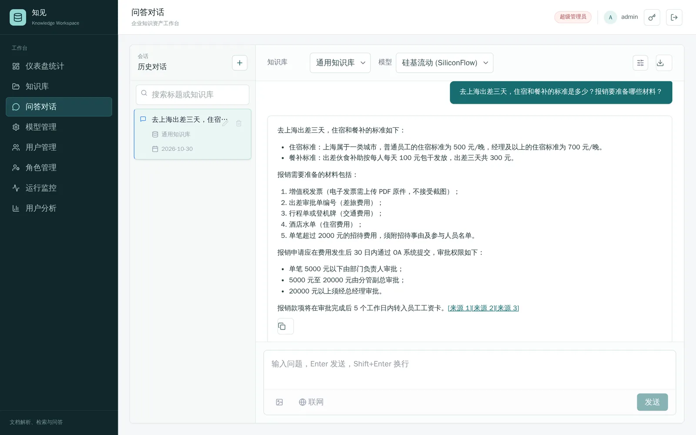
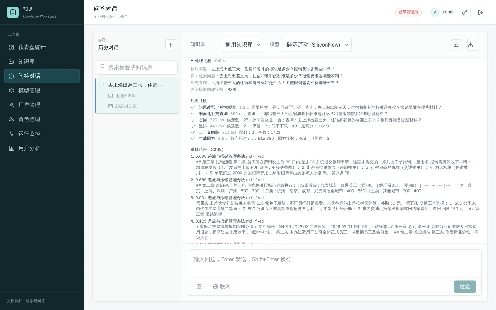
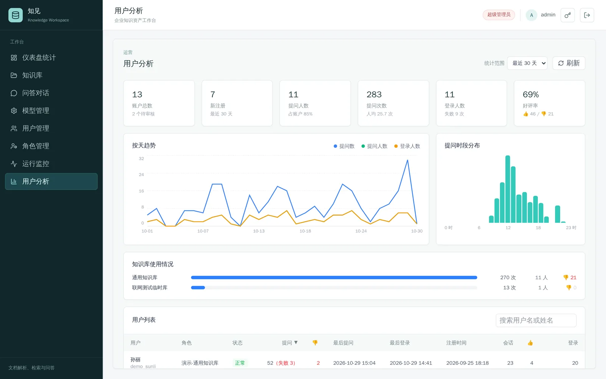
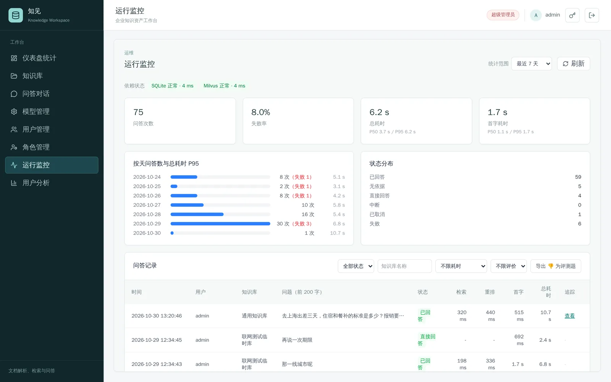
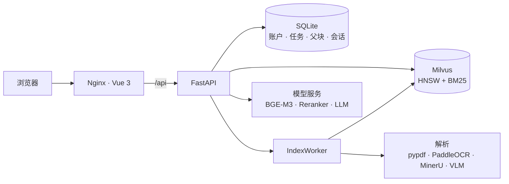

<div align="center">

# RAGLoom

**面向企业文档的 RAG 知识库与问答系统**

[](https://github.com/zcy072/ragloom/actions/workflows/ci.yml)


[界面](#界面) · [特性](#特性) · [架构](#架构) · [检索评测](#检索评测) · [快速开始](#快速开始) · [开发](#开发)

</div>

RAGLoom 把 PDF、Word、Markdown 和图片解析、分块后写入 Milvus 混合索引，经混合召回、重排序和父块恢复生成带来源角标的流式回答，并内置权限管理、运行追踪与离线检索评测。

## 界面

<p align="center">
  
</p>

<table>
  <tr>
    <td width="33%"></td>
    <td width="33%"></td>
    <td width="33%"></td>
  </tr>
  <tr>
    <td align="center"><sub>处理过程：各阶段耗时、召回与重排明细</sub></td>
    <td align="center"><sub>用户分析：提问趋势、时段分布、知识库使用</sub></td>
    <td align="center"><sub>运行监控：依赖健康、索引任务、问答记录</sub></td>
  </tr>
</table>

## 特性

- **混合检索**：Milvus 库内 RRF 融合 HNSW 稠密向量与 BM25，按路线和知识库加权，跨路线去重后经 BGE Reranker 重排。
- **三路分块**：父子块负责召回与语境恢复，结构化分块保留标题链和表格，视觉内容补充图片证据。
- **多种解析**：本地文本、PaddleOCR、MinerU 云端解析、视觉模型，失败自动回退。
- **可靠回答**：重排分数低于阈值时直接拒答、不调用大模型；回答附 `[来源 N]`，可追溯到文件和页码。
- **异步索引**：持久化任务 + 线程池；解析与嵌入不持锁，发布时 CAS 校验，重传自动作废旧任务，重启后自动恢复。
- **权限与安全**：角色与知识库级权限逐请求校验，HMAC 令牌，API Key 加密存储并支持密钥轮换，登录与问答限流。
- **可观测**：问答全链路阶段追踪、召回与重排明细、运维监控、用户分析。

## 架构



| 链路 | 流程 |
| --- | --- |
| 入库 | 上传 → 持久化任务 → 解析 → 三路分块 → 嵌入 → 父块写 SQLite、子块写 Milvus |
| 问答 | 会话记忆 → 追问改写 → 混合召回 → 去重 → 重排与阈值过滤 → 父块恢复 → SSE 流式回答 |

## 检索评测

基于 [CRUD-RAG](https://github.com/IAAR-Shanghai/CRUD_RAG) 多文档问答任务，1223 篇文档经完整入库链路，随机抽取 200 题，配置与线上默认一致。

| 配置 | hit@1 | hit@5 | full@5 | MRR | p50 |
| --- | ---: | ---: | ---: | ---: | ---: |
| BM25 | 0.840 | 0.955 | 0.715 | 0.896 | 9 ms |
| 向量 | 0.885 | 0.970 | 0.765 | 0.921 | 179 ms |
| 混合 | 0.875 | 0.975 | 0.770 | 0.917 | 212 ms |
| **混合 + 重排** | **0.915** | **0.980** | **0.820** | **0.945** | 414 ms |

`full@5` 指前 5 个文档覆盖全部标准文档的题目比例。评测结果用于确定重排保留数（10 → 20）和补充检索默认关闭。指标定义与复现见 [`evaluation/`](evaluation/README.md)。

## 快速开始

需要 Docker、[SiliconFlow](https://siliconflow.cn) API Key 和一个 OpenAI 兼容的聊天模型。

```bash
git clone https://github.com/zcy072/ragloom.git && cd ragloom
cp .env.example .env    # 填写 MODEL_API_KEY_ENCRYPTION_KEY：openssl rand -hex 32
mkdir -p storage && docker compose up -d --build
```

访问 `http://localhost:8080`，用 `admin` 登录（初始密码见 `storage/data/initial_admin_password.txt`），在“模型管理”配置模型后即可上传文档、开始问答。

<details>
<summary>配置、镜像源与数据去向</summary>

<br>

全部配置项见 [`.env.example`](.env.example)，常用的有：

| 变量 | 说明 |
| --- | --- |
| `INDEX_WORKER_THREADS` | 并行索引文档数，默认 3 |
| `RAG_IMAGE_ANALYSIS` | 图片分析：`auto` / `ocr` / `disabled` |
| `MINERU_API_TOKEN` | 使用 MinerU 云端解析时需要 |
| `RERANK_BASE_URL` / `RERANK_MODEL` | 自定义重排服务，默认 SiliconFlow |
| `CHAT_RETRIEVAL_PLANNING` / `CHAT_QUERY_VARIANT` | 检索规划与补充查询，默认关闭 |
| `DOCKER_LIBRARY_PREFIX` / `PIP_INDEX_URL` / `NPM_REGISTRY` / `MILVUS_IMAGE` | 构建镜像源，默认使用国内镜像 |

嵌入与重排发送文本到 SiliconFlow，聊天发送问题与上下文到所选模型服务商，MinerU 与视觉模型会接收原文件或图片。不希望文件外发时，选择本地解析并将图片分析设为 `ocr`。

备份时复制 `storage/` 并另行保管 `MODEL_API_KEY_ENCRYPTION_KEY`。重置数据：`docker compose down && rm -rf storage && mkdir storage && docker compose up -d`。

</details>

## 开发

```text
routers/            HTTP 路由与鉴权
services/
  core/             配置、schema、依赖容器、密钥加密
  identity/         账户、角色、令牌、限流
  documents/        解析、OCR、MinerU、视觉内容
  indexing/         分块、持久化任务、worker、锁
  retrieval/        Milvus 适配、混合召回、上下文恢复
  chat/             改写、重排、引用、会话、流式回答
frontend/           Vue 3 前端与 Playwright 测试
evaluation/         离线检索评测
```

```bash
./scripts/check.sh                                # Ruff、Pyright、后端 516 个测试、前端单元与端到端测试
SMOKE_ADMIN_PASSWORD=... ./scripts/smoke-test.sh  # 部署冒烟测试
./evaluation/run_docker.sh                        # 检索评测
```

## License

[MIT](LICENSE)
