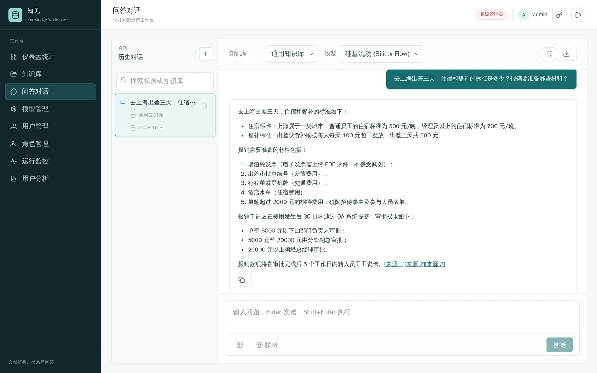
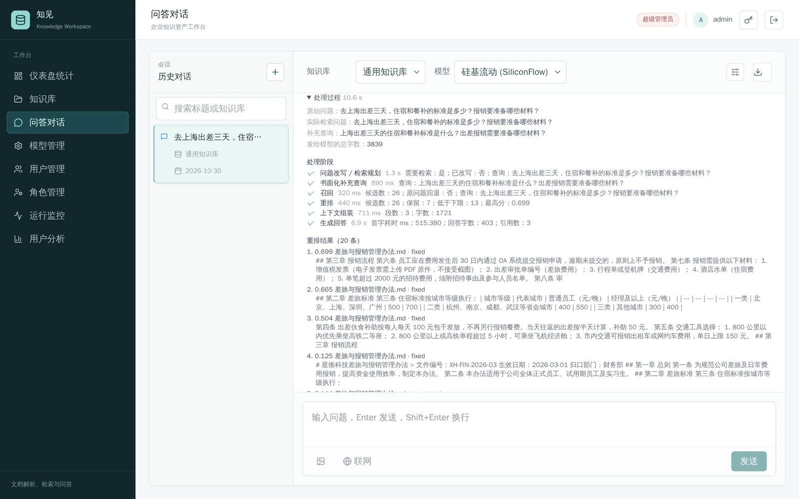
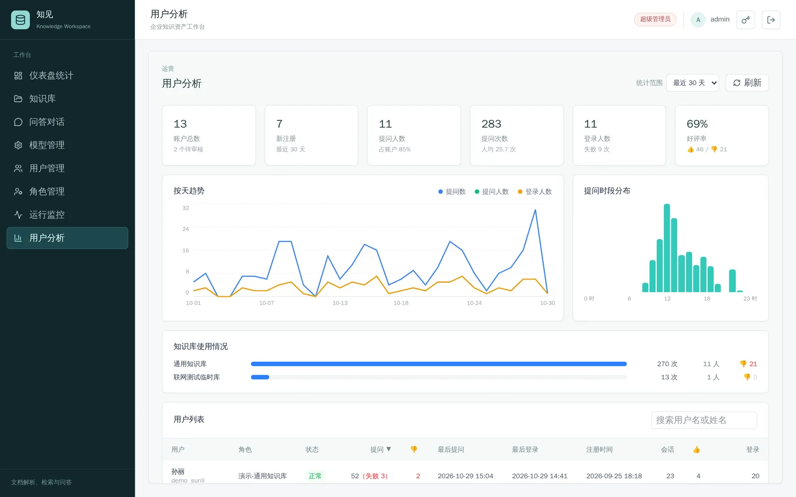
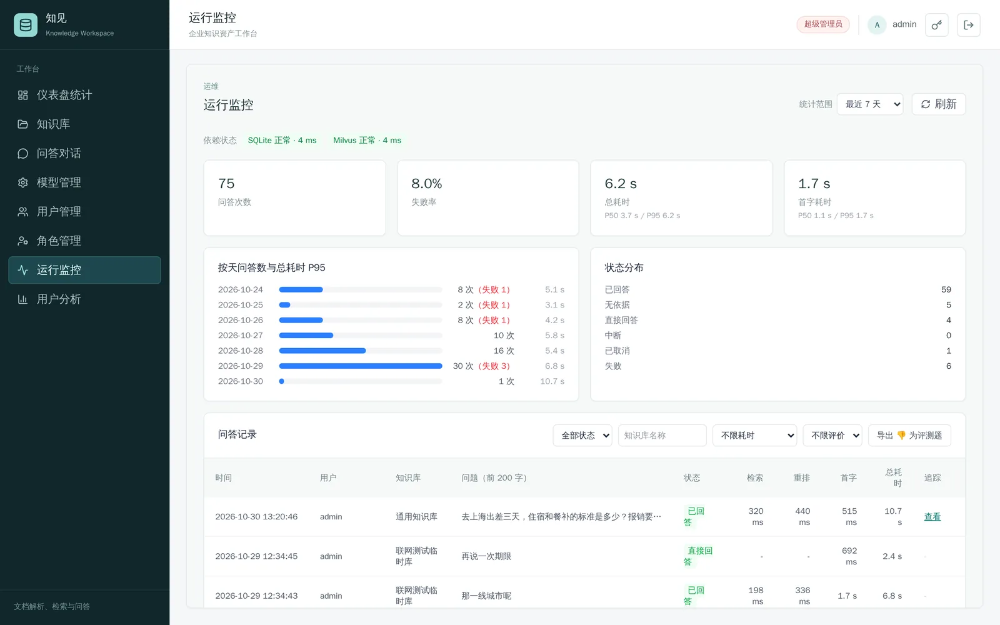
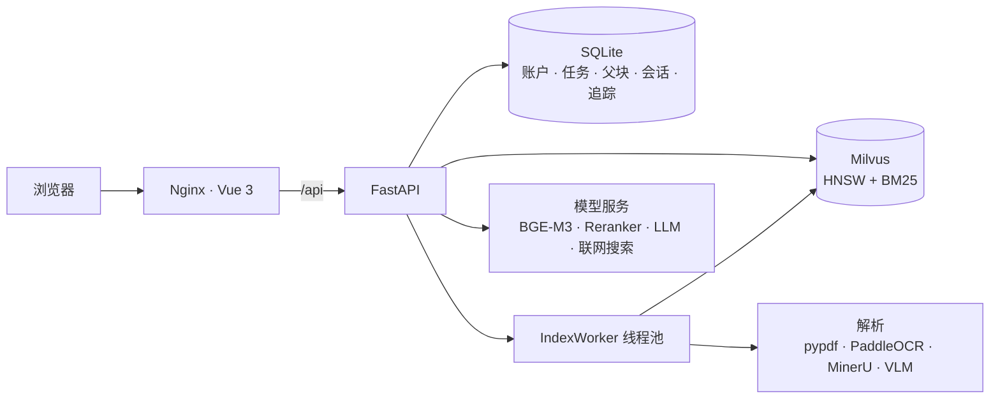

<div align="center">

# RAGLoom

**面向企业文档的 RAG 知识库与问答系统**

[](https://github.com/zcy072/ragloom/actions/workflows/ci.yml)


[界面](#界面) · [特性](#特性) · [架构](#架构) · [工程细节](#工程细节) · [检索评测](#检索评测) · [快速开始](#快速开始) · [开发](#开发)

</div>

RAGLoom 把 PDF、Word、Markdown 和图片解析、分块后写入 Milvus 混合索引，经混合召回、重排序和父块恢复生成带来源角标的流式回答。系统内置多知识库权限、会话记忆、联网搜索、全链路追踪与离线检索评测，用 Docker Compose 一条命令部署。

## 界面

<p align="center">
  
</p>

<table>
  <tr>
    <td width="33%"></td>
    <td width="33%"></td>
    <td width="33%"></td>
  </tr>
  <tr>
    <td align="center"><sub>处理过程：各阶段耗时、召回与重排明细</sub></td>
    <td align="center"><sub>用户分析：提问趋势、时段分布、知识库使用</sub></td>
    <td align="center"><sub>运行监控：依赖健康、索引任务、问答记录</sub></td>
  </tr>
</table>

## 特性

**文档入库**

- **多种解析**：本地文本层、PaddleOCR（PP-OCRv6，含页面方向纠正）、MinerU 云端解析、视觉模型。图片的视觉分析失败时改用本地 OCR，OCR 某页为空时读取 PDF 文本层。
- **三路分块**：父子块负责召回与语境恢复，结构化分块保留标题链和表格，视觉内容补充图片证据。
- **异步索引**：任务先持久化到 SQLite 再唤醒线程池，同一知识库的多个文档并行解析与嵌入；重启后排队任务继续执行，重新索引期间旧版本始终可检索。

**检索与问答**

- **混合检索**：Milvus 库内用 RRF 融合 HNSW 稠密向量与 BM25，按路线加权，跨路线去重后经 BGE Reranker 重排，再恢复父块与相邻块组成上下文。
- **证据约束**：重排分数全部低于阈值时直接拒答、不调用大模型；回答带 `[来源 N]` 角标，可追溯到文件和页码。
- **会话记忆**：早期轮次增量摘要，近期轮次保留原文；省略主语的追问先改写成独立问题再检索，提示中附带最近引用过的文件名，帮助模型确认指代。
- **联网搜索**：按角色授权，网页结果与知识库检索并行获取，作为独立来源进入上下文。
- **可选增强**：工具化检索规划（闲聊和改写类问题跳过检索）、书面化补充查询、多轮补充检索，均可按配置开启。

**平台能力**

- **权限与安全**：角色与知识库级权限逐请求校验，权限委派不能越级；服务端会话（HttpOnly Cookie，空闲滑动续期）加 CSRF 请求头；模型 API Key 以 Fernet 加密存储；登录、注册与问答限流。
- **可观测**：每次问答记录各阶段状态、耗时、召回与重排明细、上下文来源，并自动给出排查提示；运维监控页查看依赖健康和索引任务；用户的 👎 评价可导出为评测题。
- **用户分析**：提问趋势、活跃时段、知识库使用分布；查看用户完整对话需要单独授权，并写入审计记录。

## 架构



| 链路 | 流程 |
| --- | --- |
| 入库 | 上传 → 持久化任务 → 解析 → 三路分块 → 嵌入 → 父块写 SQLite、子块写 Milvus |
| 问答 | 会话记忆 → 追问改写 → 混合召回 → 去重 → 重排与阈值过滤 → 父块恢复 → SSE 流式回答 → 保存消息与引用 |

| 层 | 技术 |
| --- | --- |
| 后端 | Python 3.12、FastAPI、LangChain（模型客户端）、pymilvus、SQLite（WAL） |
| 检索 | Milvus 2.6 Standalone：HNSW 稠密向量 + 内置 BM25 稀疏索引，库内 RRF 融合 |
| 模型 | 嵌入 BAAI/bge-m3、重排 bge-reranker-v2-m3（SiliconFlow）；聊天模型支持任意 OpenAI 兼容接口 |
| 解析 | pypdf、python-docx、PaddleOCR 3.x、MinerU API、视觉大模型 |
| 前端 | Vue 3、Vite、Tailwind CSS，Nginx 托管并反向代理 |
| 质量 | Ruff、Pyright、unittest（600+ 用例）、Node 单元测试、Playwright 端到端测试、GitHub Actions |

## 工程细节

SQLite 事务无法覆盖文件系统和 Milvus，项目里多数复杂度来自如何在多资源、并发和故障下保持一致。几个代表性的设计：

- **解析不持锁，发布持锁**：索引分为“持锁准备 → 无锁解析与嵌入 → 持锁发布”三段，耗时的解析和嵌入可并行。发布前校验当前任务仍是该文档最新的索引请求，被新请求替代的旧任务直接放弃，不会覆盖新结果。
- **无中断的版本切换**：发布顺序固定为“追加新父块 → 写入新一代 Milvus 子块 → 删除旧一代子块 → 延迟删除旧父块”。切换期间新旧两代按 generation 隔离、各自都能回表；Milvus 写入失败时撤销新一代，旧版本继续可用。
- **两级锁**：单文档变更持文件锁（共享知识库），整库重建或删除持知识库独占锁，多个文档的上传与重新索引互不阻塞。
- **可恢复的故障点**：文档状态区分“解析中”和“发布中”，服务重启时还没开始发布的重建文档回到就绪并保留旧版本，已开始发布的标为错误；删除任务自动重试，未完成的知识库删除在 worker 启动前收尾。
- **检索缓存一致性**：检索器缓存带失效计数，构建期间若有文档发布就不写入，避免缓存住缺少新路线或新文档的检索计划。
- **安全细节**：用户名不存在时也执行一次 bcrypt，响应时间不泄露账号是否存在；登录限流在校验密码前原子占名额，并发请求无法绕过；认证与模型接口的校验错误不回显输入，避免密码或密钥出现在响应里。
- **流式回答**：SSE 心跳不取消上游生成器；客户端断开时仍保存已生成的部分回答；聊天模型建连超时 5 秒，在收到第一个响应前失败时自动重试一次。

完整设计与取舍见 [`docs/development/`](docs/development/)。

## 检索评测

基于 [CRUD-RAG](https://github.com/IAAR-Shanghai/CRUD_RAG) 多文档问答任务：1223 篇新闻（423 篇标准文档 + 800 篇干扰文档）经完整入库链路，随机抽取 200 题，配置与线上默认一致。

| 配置 | hit@1 | hit@5 | full@5 | MRR | P50 |
| --- | ---: | ---: | ---: | ---: | ---: |
| BM25 | 0.840 | 0.955 | 0.715 | 0.896 | 10 ms |
| 向量 | 0.890 | 0.980 | 0.765 | 0.927 | 185 ms |
| 混合 | 0.895 | 0.975 | 0.770 | 0.928 | 28 ms |
| **混合 + 重排** | **0.910** | 0.965 | **0.820** | **0.936** | 310 ms |

`full@5` 指前 5 个文档覆盖全部标准文档的题目比例。向量一行的耗时包含查询嵌入，混合与重排复用同一查询向量，不含嵌入调用。重排一行包含 4 道因最高分低于 0.05 被拒答的题。评测结果用于确定重排保留数（10 → 20）、补充检索默认关闭（无召回收益、P50 延迟约 3 倍）和重排下限只用于拒答（逐条过滤会丢掉多文档题的次要证据，full@10 从 0.850 降到 0.765）。评测还发现了一个嵌入缺陷：LangChain 默认把文本先用 tiktoken 分词后再发送，BGE-M3 收到的是无意义的 token ID，修复后对照实验的向量检索 hit@1 从 0/20 恢复到 20/20。

指标定义与复现步骤见 [`backend/evaluation/`](backend/evaluation/README.md)，完整分析见 [`docs/development/检索评测.md`](docs/development/检索评测.md)。

## 快速开始

需要 Docker、[SiliconFlow](https://siliconflow.cn) API Key（嵌入与重排）和一个 OpenAI 兼容的聊天模型。

```bash
git clone https://github.com/zcy072/ragloom.git && cd ragloom
cp .env.example .env    # 填写 MODEL_API_KEY_ENCRYPTION_KEY，生成方式见 .env.example
mkdir -p storage && docker compose up -d --build
```

访问 `http://localhost:8080`，用 `admin` 登录（初始密码见 `storage/data/initial_admin_password.txt`），在“模型管理”配置模型后即可上传文档、开始问答。

<details>
<summary>配置、镜像源与数据去向</summary>

<br>

`.env.example` 只列出常用项，全部配置项、默认值和取值范围见 [`docs/development/配置项.md`](docs/development/配置项.md)。常用的有：

| 变量 | 说明 |
| --- | --- |
| `INDEX_WORKER_THREADS` | 并行索引文档数，默认 3 |
| `RAG_IMAGE_ANALYSIS` | 图片分析：`auto` / `ocr` / `disabled` |
| `MINERU_API_TOKEN` | 使用 MinerU 云端解析时需要 |
| `AUTH_COOKIE_SECURE` | 经 HTTPS 访问时设为 `true` |
| `RERANK_BASE_URL` / `RERANK_MODEL` | 自定义重排服务，默认 SiliconFlow |
| `CHAT_AUX_MODEL_PROVIDER` | 改写、摘要等辅助调用使用的模型服务商，默认与回答模型相同 |
| `CHAT_RETRIEVAL_PLANNING` / `CHAT_QUERY_VARIANT` | 检索规划与补充查询，默认关闭 |
| `DOCKER_LIBRARY_PREFIX` / `PIP_INDEX_URL` / `NPM_REGISTRY` / `MILVUS_IMAGE` | 构建镜像源；PyPI 默认官方源，其余默认国内镜像 |

嵌入与重排发送文本到 SiliconFlow，聊天发送问题与上下文到所选模型服务商，联网搜索发送问题到 DeepSeek，MinerU 与视觉模型会接收原文件或图片。不希望文件外发时，选择本地解析并将图片分析设为 `ocr`。

备份时复制 `storage/` 并另行保管 `MODEL_API_KEY_ENCRYPTION_KEY`；Milvus 索引是派生数据，可在“知识库管理”中重建。重置数据：`docker compose down -v && rm -rf storage && mkdir storage && docker compose up -d`（`-v` 会同时删除 Milvus 数据卷和 OCR 模型卷）。

</details>

## 开发

```text
backend/
  routers/          HTTP 路由、鉴权依赖与响应模型
  services/
    core/           配置、schema、依赖容器、密钥加密
    identity/       账户、角色、会话、限流
    documents/      解析、OCR、MinerU、视觉内容
    indexing/       分块、持久化任务、worker、两级锁
    retrieval/      Milvus 适配、混合召回、上下文恢复
    chat/           改写、重排、引用、会话记忆、联网搜索、流式回答、追踪
    analytics/      用户分析与审计
  tests/            后端测试
  evaluation/       离线检索评测
frontend/           Vue 3 前端、Node 单元测试与 Playwright 测试
scripts/            check.sh、smoke-test.sh
docs/development/   架构、存储、索引、检索问答、配置项、评测与交付文档
```

```bash
./scripts/check.sh                                # Ruff、Pyright、后端测试、前端单元测试；加 --e2e 跑端到端测试
SMOKE_ADMIN_PASSWORD=... ./scripts/smoke-test.sh  # 部署冒烟测试
./backend/evaluation/run_docker.sh                # 检索评测
```

| 文档 | 内容 |
| --- | --- |
| [架构与边界](docs/development/架构与边界.md) | 模块划分、依赖方向、生命周期、身份权限、多资源一致性 |
| [数据与存储](docs/development/数据与存储.md) | 存储布局、SQLite 表、Milvus collection、重建规则 |
| [文档处理与索引](docs/development/文档处理与索引.md) | 解析策略、三路分块、并发与锁、发布顺序 |
| [检索、问答与会话](docs/development/检索问答与会话.md) | 改写与规划、混合召回、重排、上下文、记忆、追踪 |
| [配置项](docs/development/配置项.md) | 全部环境变量、默认值与取值范围 |
| [开发与交付](docs/development/开发与交付.md) | 测试、依赖锁定、OpenAPI 契约、变更规则 |
| [检索评测](docs/development/检索评测.md) | 评测设置、结果、发现的缺陷与解读 |

## License

[MIT](LICENSE)
